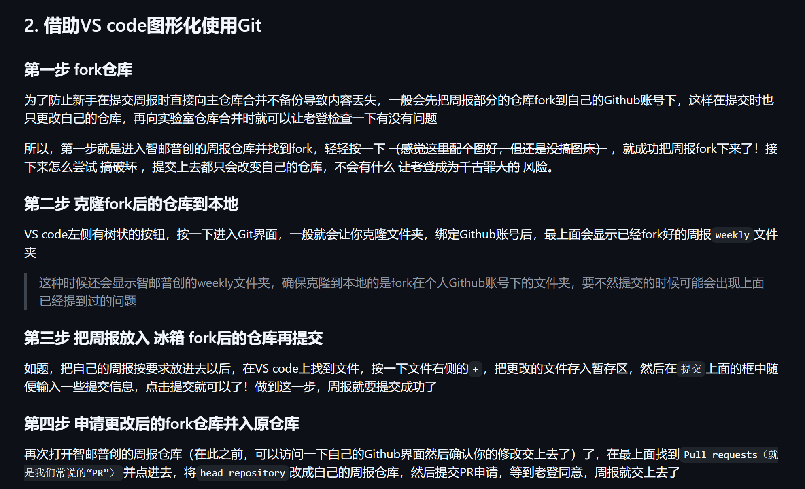

# 前言
感觉一周一报的格式不太适合我，索性就当日记写了，可能中间会夹带点私货，用词也没那么正式哈
# 10.19-10.22
简单学习了一下markdown，git命令
## markdown知识总结
### 一·标题
Ctal + 加号/减号 调整级别
### 二·段落
1·换行

Enter 段落间

shift + Enter 段落内

2.分割线

“---”或“+++” + Enter
### 三·文字显示
1·字体

**粗体**

~~删除线~~

<u>下划线</u>

*斜体*

<mark>高亮</mark>
2.特殊字符

乘号：\ + 乘号

反斜杠： \ + \

1\*2\*3
### 四·列表
1.无序列表 加号或减号 加上一个空格

+ 张三

+ 李四
2.有序列表

数字 加 . 加 空格

1. 张三

2. 王五
3.任务列表

减号 加空格 加 [  加 空格 加 ]

- [ ] 任务一
- [ ] 任务二
### 五.区块显示

右尖括号 加 回车或空格    (">")

shift 加 Enter 同层换行

### 六.代码显示

1.行内代码

反引号 加 代码 加 反引号

快捷键 Ctrl+ Shift + `

`int a =0;`

2.代码块

快捷键：Ctrl + Shift + K

或者 ``` + Enter


### 七.链接

1. Ctrl 再点
2. [百度一下](网址) （[文本]（网址））
3. [文本]（网址“网址”） ~~这个鼠标悬浮的时候可以显示网址~~

快捷键 Ctrl + K
### 八.脚注

1. 正文[^文本]

2. [^文本]: 解释说明
### 九.图片插入

！[不显示文本](图片路径“图片标题”)

！ 加 [] 加 (图片路径“图片标题”)

快捷键 Ctrl + Shift + I(大写i)
 ### 十.表格

Ctrl + T
## 感言
缺少一些灵活的思考和自己的理解，刚开始学习还没有自己的节奏。对知识一知半解，其实我学习了很久的git命令，但是吧，约等于没学，好多操作和名词对我来说完全不懂，他们到底在说什么呀~~我不要当傻子~~。fork直到10.22我才知道从哪搞，搞到哪里去。怎么把fork克隆到本地，怎么在vs code里上传周报（ps:来自李润涛同学的指导，~~我两真的是同一批进来的萌新吗~~）也是看了他的周报决定重修一下周报，改变一下学习策略。顺带还在ai的指导下搭建了博客。
## 计划
暂时还没想好，先把git命令的学习笔记补一下吧

# 10.24
## 借助vscode图形化使用git
这里引用一下别人的周报哈，我个人觉得他理解的比我好多了，且简单易懂，我是看他的学会的。

- 卡了我很久的点就是fork仓库，操作就是点一下fork，弄一个属于自己的仓库，就fork好了，不用再进行别的操作了，直接到vscode上找到初始化仓库克隆。
- 提交的方法是再GitHub中自己的仓库里找到周报所在的fork，点击contribute，选择open pull request,在下一个界面添加一个title，滑动到最下方点击create pull request，这样好啦，等待负责人合并你的仓库，你的周报就成功提交了
## 感言
这周过得挺快的，学得东西比较少，还在摸索适合自己的学习方式
## 计划
在下一周打算简单学习一下python或者Linux吧，主要看老大那有什么学习安排吧