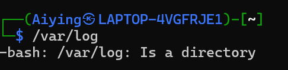

# 10.25

## 1.Linux基础

### 1.1 概念

| 术语             | 解释                                                         |
| ---------------- | ------------------------------------------------------------ |
| Terminal（终端） | 就是黑色窗口。只显示字符，不干活                             |
| Shell            | 读命令的程序                                                 |
| command(命令)    | 一个可执行程序。ls(list的缩写)就是/usr/bin/ls                |
| 参数/选项        | `ls -l /etc` : `-l` 是选项，`/etc` 是参数（操作对象）        |
| REPL             | 读一行-执行-打印-循环。在 shell 里敲命令就是 REPL，报错不会退出，可以一直试 |
| root             | 超级管理员，UID 0，干什么都没人阻拦，**日常慎用**            |
| sudo             | **临时工**，用当前用户身份，临时以root执行**一条**命令       |
| Ctrl + C         | 中断当前正在执行的命令（不是复制！！！Linux里的**复制**是**Ctrl+Shift+C**）（**粘贴**是**Ctrl+Shift+V**） |
| Ctrl + D         | 输入结束/推出登录                                            |
| Ctrl + L         | 清屏（=clear）                                               |

## 1.2.提示符怎么读 

tan@DESKTOP-XXXX:~$ 
 │               │       │          └─ $ 表示普通用户（# 表示 root）
 │               │       └─── 当前目录，~ 就是家目录
 │               └────────────── 主机名
 └───────────────────── 当前用户名


### 1.3.速查（五个元命令）

| 命令                | 作用                                  |
| ------------------- | ------------------------------------- |
| whoami              | 我是谁                                |
| hostname            | 这台机器叫什么                        |
| cat /etc/os-release | 我装的是什么发行版（Ubuntu? Debian?） |
| man ls              | 看手册（q 退出，/词 搜索）            |
| ls --help           | 快速帮助（比 man 短）                 |
| history             | 我敲过的命令（!123 重跑第 123 条）    |

我使用的kali默认不装`man` ,可以通过`sudo apt update && sudo apt install -y man-db manpages` 装一个，或直接使用`ls --help` 够用了。

### 1.4.操作

3.0 进入wsl界面输入：wsl -d kali-linux（我安装的是kali，根据自己安装的虚拟机输入指令）

3.1 进入home的目录，刚进来时wsl会继承原先启动它时所在的Window目录。我是在c:\Users\ASUS里敲的，它就会落在这个目录，但是在这里运行会很慢，所以我们先`cd ~` 回家再干活

**注意：命令和参数之间必须有空格，`cd ~`**
    

## 2.文件系统：Linux没有C盘和D盘

### 2.1关键概念：一切从`/` 开始

Windows可以分很多盘；但是Linux更像一颗树，所有的东西都挂在树底（也就是`/`）下。“**挂载**（mount）”就是“把一个设备/分区接到树上的某个目录”--这是Docker卷，云盘必用的词。

/            根，一切的起点
├── etc      配置文件（改之前先备份！）
├── var      会变大的东西，日志在 /var/log
├── home     普通用户的家目录，你的在 /home/你
├── tmp      临时文件，重启可能被清空（练习随便造，不心疼）
├── opt      第三方软件（自己装的常放这）
├── usr      /usr/bin 里全是命令
├── bin -> /usr/bin     （符号链接，见第 3 节）
├── proc     内核和进程的"假文件"，`cat /proc/cpuinfo` 能看 CPU
└── mnt/c    Windows 的 C 盘（WSL 专用）

上面的我暂时还看不懂，先放这吧。

### 2.2绝对路径vs相对路径（注意区分哦）

| 写法                          | 叫法     | 从哪算起       | 例子                       |
| ----------------------------- | -------- | -------------- | -------------------------- |
| /etc                          | 绝对路径 | 从`/` 开始     | 在任何地方都指向同一个文件 |
| `hosts`,`./hosts`, `../hosts` | 相对路径 | 从当前目录算起 | 换个目录就指别处了         |

举个例子哈，感觉不好理解呢。

``` 
/                     ← 一切的起点，绝对路径都从这开始
├── etc
│   └── hosts         ← 它的绝对路径永远是 /etc/hosts
└── home
    └── Aiyiing       ← 你的家目录
```

`hosts` 这个文件只能有一个，但可以用不同的语言来描述它。

| 你的位置       | 怎么说（相对）    | 完整说法     |
| -------------- | ----------------- | ------------ |
| `/`            | `etc/hosts`       | `/etc/hosts` |
| `/etc`         | `hosts`           | `/etc/hosts` |
| `/home/Aiying` | `../../etc/hosts` | `/etc/hosts` |

我个人认为相对取决于你现在处在什么位置，以你的位置为参照物

**判断小技巧：看开头是不是 `/`。** 是 `/` 就是绝对路径；不是就是相对路径。

#### **拓：补充一下特殊目录名**

| 符号 | 含义                             |
| ---- | -------------------------------- |
| `~`  | 你的家目录`/home/你`             |
| `.`  | 当前目录                         |
| `..` | 上一级目录                       |
| ·-·  | 上一次待过的目录（`cd -`来回跳） |

### 常用命令

| 命令      | 作用         | 例子     |
| --------- | ------------ | -------- |
| `pwd`     | 我在哪       | `pwd`    |
| `ls`      | 列出内容     | `ls`     |
| `cd 目录` | 进去         | `cd/etc` |
| `cd/cd ~` | 回家         | ·cd·     |
| `cd ..`   | 上一级       | `cd ..`  |
| `cd -`    | 回到上一目录 | `cd -`   |


## 感言

今天挺充实的，简单了解了一下Linux的基础概念，对Linux有个基础认识，感觉Linux还怪有特点的，和Windows很不一样，竟然像一颗树。

# 10.26

## 拓：报错

`-bash: X: No such file` → **X 这个命令不存在**（往往是拼写/空格问题）； `cat: X: No such file` → **命令没问题，是 X 这个文件不存在**。 前缀不同，排查方向完全不同。



上图便是我把目录当作程序跑而产生的报错

| 报错                                  | 常见原因                   | 首先检查           |
| ------------------------------------- | -------------------------- | ------------------ |
| `command not found`                   | 命令拼错，或程序未安装     | 命令名是否正确     |
| `No such file or directory`           | 文件不存在，或当前目录不对 | `pwd`、`ls`        |
| `Permission denied`                   | 文件权限不足               | `ls -l`            |
| `missing argument` / `invalid option` | 命令缺参数，或选项不适用   | `命令 --help`      |
| `Address already in use`              | 端口被其他程序占用         | 找出占用端口的进程 |

## 3.文件相关

### 3.1看文件

| 命令         | 用在哪                     | 例子                 |
| ------------ | -------------------------- | -------------------- |
| `cat `       | 小文件                     | `cat /etc/hosts`     |
| `head -n 20` | 前20行                     | `head -n 20 x.log`   |
| `tali -n 50` | 后50行                     | `tali -n 50 x.log`   |
| `less 文件`  | **大文件首选**，可翻页可搜 | less /var/log/syslog |

**`less` 里必会的 5 个键**：`空格` 下一页 / `b` 上一页 / `/关键词` 搜索 / `n` 下一个匹配 / `q` 退出。 **忘了在 `less` 里怎么退出** → 按 `q`。

### 3.2搜文件


## 4.管道和重定向（完全没看懂啊，笔记先搁置一下）

### 4.1先理解三个"流"（没看懂，先放着）

每个命令都有三根管子：

| 流                  | 编号 | 是什么           | 默认去哪 |
| ------------------- | ---- | ---------------- | -------- |
| **stdin** 标准输入  | 0    | 命令吃进去的东西 | 键盘     |
| **stdout** 标准输出 | 1    | 正常结果         | 屏幕     |
| **stderr** 标准错误 | 2    | 报错信息         | 屏幕     |

**重定向**就是改这三根管子的去向；**管道**就是把上一个命令的 stdout 接到下一个命令的 stdin。


## 5.权限：为什么报Permission denied

### 5.1 拆开看`-rwxr-xr-x`

``` 
-   rwx   r-x   r-x
│    │     │     └── 其他人 (others) 的权限
│    │     └──────── 所属组 (group) 的权限
│    └────────────── 所有者 (user/owner) 的权限
└─────────────────── 文件类型：- 普通文件 / d 目录 / l 链接
```

### 5.2数字怎么算

`r=4,w=2,x=1` ,三组各有0-7，加起来就是三位数：

| 数值 | 长相       | 用途                       |
| ---- | ---------- | -------------------------- |
| 644  | -rw-r--r-- | 普通文件、网页、脚本源文件 |
| 755  | -rwxr-xr-x | **目录**、可执行脚本       |
| 600  | -rw------- | 私钥、密码文件             |
| 700  | -rwx------ | 私有目录，如 `.ssh`        |

eg：755 = 7(自己 rwx=4+2+1) + 5(组 r-x=4+1) + 5(其他 r-x=4+1)

## 6.`>`（覆盖） vs `>>`（追加）

```
echo a > f.txt
echo b > f.txt
cat f.txt               # 只剩 b —— 被覆盖了

echo a > f.txt
echo b >> f.txt
cat f.txt               # 两行都在
```

**典型事故**：定时任务里写 `cmd > app.log`，每天跑一次就清空一次日志，出问题时什么线索都没有。**日志永远用 `>>`。**

## 7.管道`|` (长得就很像管子)

前一个的输出 = 后一个的输入

## 8.退出码

```
ls /etc/hosts
echo $?          # 0

ls /不存在
echo $?          # 2

false
echo $?          # 1
```

| 127  | 命令找不到                    |
| ---- | ----------------------------- |
| 126  | 找到了但没权限执行            |
| 0    | 成功                          |
| 1    | 一般性失败                    |
| 2    | 误用（如 `ls` 参数/路径不对） |

## 实践

上面很多概念性的东西好多没看懂，决定先放着，先动手，把实践中遇到的问题及对应知识记录下来。

```
目标：在家目录下建一个自己的练手目录 `lab`，里面有 `logs`、`src` 两个子目录，再加一个 `hello.sh`，运行后打印 `hello, I am Aiyiing`。
```

1.建立一个多层目录

```
mkdir lab        # 先建 lab
cd lab           # 进去
mkdir logs src   # 一次建两个子目录
ls               # 确认
```

2.往文件里写内容可以用 `echo '...' > 文件名`。

```
echo 'echo hello, I am Aiyiing' > hello.sh
```

`echo` 负责生成内容，`>` 负责把这段内容写入 `hello.sh`；如果 `hello.sh` 还不存在，这一步也会顺便把它创建出来。因此**用一条命令就能完成“建文件 + 写内容”**。

  加执行权限

```
chmod +x hello.sh
```

   运行

```
./hello.sh 
```

`./` 后跟文件表示打开这个文件

### 女娲补天

- 常用缩写

| 命令    | 全称                    | 意思                        |
| ------- | ----------------------- | --------------------------- |
| `mkdir` | make directory          | 建目录                      |
| `ls`    | list                    | 列出                        |
| `cd`    | change directory        | 切换目录                    |
| `pwd`   | print working directory | 显示当前目录                |
| `rm`    | remove                  | 删除(删除空目录就是`rmdir`) |
| `cp`    | copy                    | 复制                        |
| `mv`    | move                    | 移动或改名                  |
| `cat`   | concatenate             | 拼接并输出文件内容          |
| chmod   | change mode             | 改变权限                    |

让mkdir卡了，注意mkdir用于建目录，不可以用来建文件。建文件用另一种方式。看上面演示

卡在`chmod +x`:`chmod` = change mode，改变权限;`+x` = 加上 execute（执行）权限(新建文件默认权限是644)

## 感言

还是实践快啊。

# 10.29

## 1.linux实践

### 实践1：追加内容并输出

```
目标：在上一次的基础上追加内容“bye”
```

追加使用`>>`

具体操作如下

```
echo 'echo bye' >> hello.sh
cat hello.sh
./hello.sh
```

输出：hello, I am Aiyiing
           bye

### 实践2：让脚本接收数据

现在的脚本是“死的”，每次都打印同一句话。加一个 `$1`，它就能接收你传给它的东西：

```
cd ~/lab
echo 'echo hello, $1' > hello2.sh
chmod +x hello2.sh
./hello2.sh Aiying
```

输出：

hello, Aiyinig

你还可以将`Aiying` 替换成任何你想要输出的东西

我的理解是`$n` 是黄牛，替别人（参数）占位。

| 概念 | 含义                                    |
| ---- | --------------------------------------- |
| `$1` | 运行时传入的第一个参数                  |
| `$2` | 第 2 个参数（`./x.sh a b` 就是 a 和 b） |
| `$0` | 脚本自己的名字                          |


## 10.30-10.31

## Linux的实践

### 实践3：查看和结束进程

**3.1 前后台进程**

```
sleep 120
```

`sleep` 会等待 120 秒，并占用当前终端。这种叫前台进程。此时可以按 `Ctrl+C` 结束它。

命令末尾加上`&`,会把任务放到后台执行，终端可以继续输入命令。会显示任务编号和进程编号。

```
[1] 35696
```

`[1]` 是任务编号 ；  `35696`是进程编号`PID` 

**3.2查看任务和进程**

```
jobs -l
```

会显示当前终端启动的后台任务:

```
[1]+ 35696 Running    sleep 120 &
```

接着用实际 PID 查询：

```
ps -p 35696 -o pid,ppid,stat,cmd
```

基础补充：

`PID`：进程自身编号。

`PPID`：父进程编号，通常是启动它的 Shell。

`STAT`：进程状态，`S` 通常表示正在等待。

`CMD`：启动该进程的命令

**3.3结束进程**

结束编号为 `%1` 的后台任务：

```
kill %1
```

然后确认：

```
jobs -l
```

### 实践4：报错

和前面知识点内容重复，不记了

# 本周总结

学了Linux的基础用法，还不太熟练哈，学得比较慢。

# 下周计划

开docker.